# Bug report – HW04 Automation Testing

Các bug dưới đây do bộ test tự động làm lộ ra: một assertion fail và nguyên nhân là SUT làm sai đặc tả. Issue nằm ở repo dùng chung của nhóm: `d1nhnguyen/eshop-sut`.

## 1. Tổng hợp

| Bug | Issue | Feature | Tóm tắt | Mức độ | Test case tự động làm lộ ra | Browser |
| --- | --- | --- | --- | --- | --- | --- |
| BUG-24 | [#24](https://github.com/d1nhnguyen/eshop-sut/issues/24) | FR-15 | Cho lưu Giá bằng 0 hoặc âm khi Thêm và Sửa | Major | FR15-DT-08, FR15-DT-09, FR15-DT-20 | Chromium, Firefox, WebKit |
| BUG-25 | [#25](https://github.com/d1nhnguyen/eshop-sut/issues/25) | FR-15 | Cho lưu khi bỏ trống Giá | Major | FR15-DT-10 | Chromium, Firefox, WebKit |
| BUG-26 | [#26](https://github.com/d1nhnguyen/eshop-sut/issues/26) | FR-15 | Cho lưu Tên dài hơn 255 ký tự | Major | FR15-BV-05 | Chromium, Firefox, WebKit |
| BUG-27 | [#27](https://github.com/d1nhnguyen/eshop-sut/issues/27) | FR-15 | Cho lưu Tên chỉ gồm khoảng trắng | Major | FR15-DT-06 | Chromium, Firefox, WebKit |
| BUG-41 | [#87](https://github.com/d1nhnguyen/eshop-sut/issues/87) | FR-15 | Sau khi Sửa, bảng sản phẩm hiển thị sai cho tới khi tải lại trang | Major (tôi đề xuất) | FR15-DT-15, FR15-DT-34, FR15-DT-20 | Chromium, Firefox, WebKit |
| BUG-15 | [#15](https://github.com/d1nhnguyen/eshop-sut/issues/15) (trùng nội dung: [#110](https://github.com/d1nhnguyen/eshop-sut/issues/110)) | FR-01 | Form Đăng ký báo "Mật khẩu quá yếu" với mọi mật khẩu hợp lệ, lại nhận mật khẩu có dấu cách | Critical | FR01-DT-01, BV-04, BV-14, DT-11, DT-17, DT-29, DT-27 | Chromium, Firefox, WebKit |
| BUG-16 | [#16](https://github.com/d1nhnguyen/eshop-sut/issues/16) (trùng nội dung: [#113](https://github.com/d1nhnguyen/eshop-sut/issues/113)) | FR-01 | Form Đăng ký thiếu ô Xác nhận mật khẩu | Major | FR01-DT-27 | Chromium, Firefox, WebKit |
| BUG-18 | [#18](https://github.com/d1nhnguyen/eshop-sut/issues/18) | FR-01 | API đăng ký nhận email sai định dạng | Major | FR01-WA-11 | Chromium, Firefox, WebKit |
| BUG-19 | [#19](https://github.com/d1nhnguyen/eshop-sut/issues/19) | FR-01 | API đăng ký nhận mật khẩu không đủ mạnh | Major | FR01-DT-29 | Chromium, Firefox, WebKit |
| BUG-20 | [#20](https://github.com/d1nhnguyen/eshop-sut/issues/20) (trùng nội dung: [#112](https://github.com/d1nhnguyen/eshop-sut/issues/112)) | FR-01 | Cho đăng ký bằng email đã tồn tại | Critical | FR01-WA-17 | Chromium, Firefox, WebKit |
| BUG-21 | [#21](https://github.com/d1nhnguyen/eshop-sut/issues/21) (trùng nội dung: [#111](https://github.com/d1nhnguyen/eshop-sut/issues/111)) | FR-01 | Ô Email dùng `type="text"`, không kiểm tra định dạng | Minor | FR01-WA-11 | Chromium, Firefox, WebKit |
| BUG-30 | [#30](https://github.com/d1nhnguyen/eshop-sut/issues/30) | FR-10 | Đơn đã hủy chuyển được sang "Đã giao"; Web Admin hiện nút "Đánh dấu Đã giao" | Critical | FR10-DT-09, FR10-UI-01 | Chromium, Firefox, WebKit |
| BUG-31 | [#31](https://github.com/d1nhnguyen/eshop-sut/issues/31) (trùng nội dung: [#115](https://github.com/d1nhnguyen/eshop-sut/issues/115)) | FR-10 | User hủy được đơn đang giao; trang Hồ sơ hiện nút "Hủy đơn" | Major | FR10-DT-14, FR10-DT-27 | Chromium, Firefox, WebKit |

**Lưu ý về mã bug:** `BUG-41` là mã trong tiêu đề của **issue #87**, không phải issue #41. Từ HW03, mã BUG-xx của nhóm không còn trùng với số issue trên GitHub. BUG-24 đến BUG-27 thì trùng số issue #24 đến #27.

Nguồn gốc issue:

- BUG-15 đến BUG-21 (FR-01) và BUG-30, BUG-31 (FR-10) do tôi tạo ở HW02. Cột "Browser" ghi theo chín report chính thức ngày 2026-11-18; mọi test fail cho cùng kết quả trên cả ba browser. Các issue trùng nội dung (#110–#113, #115) do thành viên khác tạo ở HW03; mức độ giữ theo issue gốc của tôi.
- Mã BUG trong tiêu đề không duy nhất trên tracker (ví dụ BUG-43, BUG-44, BUG-45 mỗi mã có hai issue), nên bảng luôn ghi kèm số issue.
- BUG-24 đến BUG-27 do tôi tạo ở HW02 (kiểm thử thủ công và qua API). HW04 tái hiện lại chúng bằng test tự động trên Web Admin. Mức độ giữ theo HW02.
- BUG-41 do thành viên khác trong nhóm tạo ngày 2026-11-10. Test của tôi tái hiện bug này và bổ sung ba chi tiết ở mục 2.5.

Bằng chứng:

- **Kết quả chạy:** mở `reports/fr15-<browser>/index.html`, chọn test case tương ứng. Mỗi test fail có danh sách assertion fail và annotation `Bug`.
- **Ảnh:** năm ảnh trong `bugs/screenshots/` chụp riêng bảng sản phẩm ngay sau thao tác. Chúng do chính test tự động chụp trong một lượt chạy riêng trên Chromium ngày 2026-11-17, sau khi test được bổ sung bước chụp bảng (commit `328221b`). Ba report chính thức FR-15 trong `reports/` (chạy lại ngày 2026-11-18) cũng có ảnh bảng này, đính trong mỗi test với tên "Bảng sản phẩm sau thao tác". Ảnh của FR-01 và FR-10 (mục 2.6–2.12) được chép từ các report chính thức trên Chromium ngày 2026-11-18.
- **Trên GitHub:** mỗi issue có một bình luận ngày 2026-11-17 kèm đúng ảnh tương ứng.

## 2. Chi tiết

### 2.1 BUG-24 – Cho lưu Giá bằng 0 hoặc âm khi Thêm và Sửa

- **Đặc tả (FR-15):** "Giá: bắt buộc, phải là số **dương** (> 0)."
- **Test case:** FR15-DT-08 (Thêm, Giá `0`), FR15-DT-09 (Thêm, Giá `-50000`), FR15-DT-20 (Sửa Giá thành `0`).
- **Các bước (Thêm):**
  1. Đăng nhập Web Admin bằng tài khoản admin, mở mục Sản phẩm.
  2. Nhập Tên `Sac nhanh USB-C 20W <hậu tố>`, Giá `0` (hoặc `-50000`), chọn Danh mục `Phụ kiện`.
  3. Bấm "Lưu sản phẩm".
- **Mong đợi:** hệ thống từ chối; không có sản phẩm mới trên bảng và phía server.
- **Thực tế:** `POST /api/products` trả 200; bảng có thêm một dòng; `GET /api/products` có thêm một sản phẩm.
- **Thực tế (Sửa, FR15-DT-20):** `PUT /api/products/<id>` trả 200; phía server Giá của sản phẩm thành `0` thay vì giữ `28000000`.
- **Ảnh:** `bugs/screenshots/BUG-24_FR15-DT-08_chromium_table.png` ([bình luận trên issue](https://github.com/d1nhnguyen/eshop-sut/issues/24#issuecomment-6945939330))


### 2.2 BUG-25 – Cho lưu khi bỏ trống Giá

- **Đặc tả (FR-15):** "Giá: bắt buộc, phải là số **dương** (> 0)."
- **Test case:** FR15-DT-10.
- **Các bước:** như 2.1, để trống ô Giá.
- **Mong đợi:** hệ thống từ chối; không có sản phẩm mới.
- **Thực tế:** `POST /api/products` trả 200; bảng và server có thêm một sản phẩm. Ô Giá không có thuộc tính bắt buộc nên trình duyệt không chặn.
- **Ảnh:** `bugs/screenshots/BUG-25_FR15-DT-10_chromium_table.png` ([bình luận trên issue](https://github.com/d1nhnguyen/eshop-sut/issues/25#issuecomment-6945940225))


### 2.3 BUG-26 – Cho lưu Tên dài hơn 255 ký tự

- **Đặc tả (FR-15):** "Tên sản phẩm: bắt buộc, tối đa 255 ký tự."
- **Test case:** FR15-BV-05 (Tên 256 ký tự). Case cặp FR15-BV-04 (Tên 255 ký tự) pass.
- **Các bước:** như 2.1, nhập Tên dài đúng 256 ký tự, Giá `350000`.
- **Mong đợi:** hệ thống từ chối; không có sản phẩm mới.
- **Thực tế:** ô Tên nhận đủ 256 ký tự; yêu cầu gửi đi mang Tên dài 256 ký tự; `POST /api/products` trả 200; bảng và server có thêm một sản phẩm.
- **Ảnh:** `bugs/screenshots/BUG-26_FR15-BV-05_chromium_table.png` ([bình luận trên issue](https://github.com/d1nhnguyen/eshop-sut/issues/26#issuecomment-6945941119))


### 2.4 BUG-27 – Cho lưu Tên chỉ gồm khoảng trắng

- **Đặc tả (FR-15):** "Tên sản phẩm: bắt buộc, tối đa 255 ký tự." Giả định A2 của HW02: tên chỉ gồm khoảng trắng coi như bỏ trống.
- **Test case:** FR15-DT-06. Case cặp FR15-DT-05 (Tên rỗng) pass vì trình duyệt chặn.
- **Các bước:** như 2.1, nhập Tên là 3 dấu cách, Giá `350000`.
- **Mong đợi:** hệ thống từ chối; không có sản phẩm mới.
- **Thực tế:** `POST /api/products` trả 200; bảng và server có thêm một sản phẩm có Tên là 3 dấu cách (trên bảng hiện ô Tên trống).
- **Ảnh:** `bugs/screenshots/BUG-27_FR15-DT-06_chromium_table.png` ([bình luận trên issue](https://github.com/d1nhnguyen/eshop-sut/issues/27#issuecomment-6945942070))

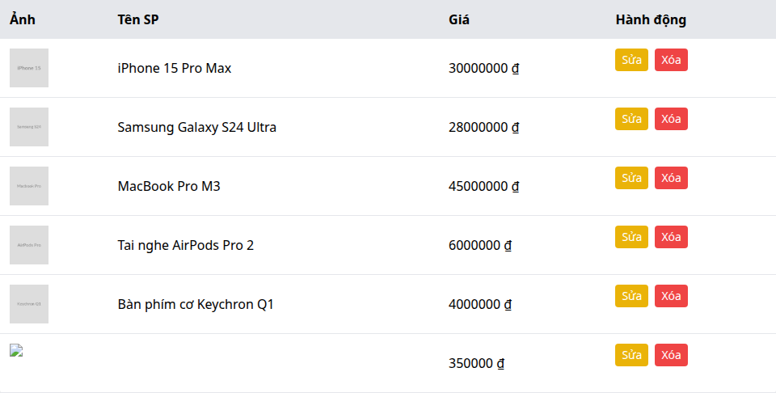

### 2.5 BUG-41 (issue #87) – Sau khi Sửa, bảng sản phẩm hiển thị sai cho tới khi tải lại trang

- **Đặc tả (FR-15):** "Khi Sửa một sản phẩm, chỉ sản phẩm đó bị thay đổi — các sản phẩm khác giữ nguyên."
- **Test case:** FR15-DT-15, FR15-DT-34 (Sửa Giá hợp lệ); FR15-DT-20 cũng gặp hiện tượng này.
- **Các bước:**
  1. Tạo một sản phẩm `MacBook Pro M3 <hậu tố>`, Giá `45000000`, Danh mục `Laptop`.
  2. Trên Web Admin, mục Sản phẩm, bấm "Sửa" ở dòng của sản phẩm đó.
  3. Chỉ đổi Giá thành `42000000`, bấm "Lưu sản phẩm", đóng alert "Cập nhật thành công!".
  4. Quan sát bảng, không tải lại trang.
- **Mong đợi:** dòng được sửa hiện Giá `42000000`; Tên và Giá của mọi dòng khác giữ nguyên.
- **Thực tế:**
  - Cột Tên của **mọi dòng** trong bảng đổi thành tên của sản phẩm vừa sửa.
  - Dòng được sửa vẫn hiện Giá cũ `45000000`.
  - Phía server dữ liệu đúng: chỉ sản phẩm được sửa đổi Giá, các sản phẩm khác không đổi. Tải lại trang thì Tên của các dòng hiển thị lại đúng.
- **Bổ sung so với issue #87:** issue gốc mô tả trường hợp sửa Tên. Test tự động cho thấy lỗi xảy ra cả khi chỉ sửa Giá, dòng được sửa không cập nhật Giá mới, và đây là lỗi hiển thị (dữ liệu phía server không bị đổi).
- **Ảnh:** `bugs/screenshots/BUG-41_FR15-DT-15_chromium_table.png` ([bình luận trên issue](https://github.com/d1nhnguyen/eshop-sut/issues/87#issuecomment-6945943089))

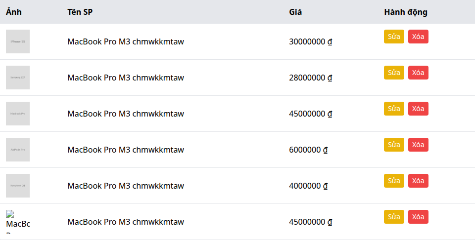

### 2.6 BUG-15 (issue #15; trùng nội dung #110) – Form Đăng ký báo "Mật khẩu quá yếu" với mọi mật khẩu hợp lệ

- **Đặc tả (FR-01, S3):** "Tối thiểu 8 ký tự, có ít nhất 1 chữ hoa, 1 chữ thường, 1 chữ số và 1 ký tự đặc biệt (`@`, `$`, `!`, `%`, `*`, `?`, `&`)."
- **Test case:** FR01-DT-01 (`Abcdef1@`), FR01-BV-04 (`Abcdefg1@`), FR01-BV-14 (Họ Tên 1 ký tự, mật khẩu `Abcdef1@`); FR01-DT-29 (`Abcdef1␣`, chiều ngược lại). BUG-15 cũng che mất phần kiểm email của FR01-DT-11, DT-17 và lý do từ chối của DT-27.
- **Các bước:**
  1. Mở `http://localhost:5173/register`.
  2. Nhập Họ Tên `Nguyen Van A`, một email chưa dùng, Mật khẩu `Abcdef1@`.
  3. Bấm "Đăng Ký".
- **Mong đợi:** đăng ký thành công, chuyển tới trang Đăng nhập (S5), đăng nhập được bằng thông tin vừa nhập.
- **Thực tế:** trang hiện "Mật khẩu quá yếu! Phải dài tối thiểu 8 ký tự, gồm chữ hoa, chữ thường, số và KÝ TỰ ĐẶC BIỆT."; không gửi yêu cầu nào; không tạo tài khoản. Ngược lại, với `Abcdef1␣` (ký tự "đặc biệt" duy nhất là dấu cách, không thuộc tập S3), form gửi yêu cầu, server trả 200 và tạo tài khoản (FR01-DT-29, cùng BUG-19).
- **Ảnh:** từ `reports/fr01-chromium/`, test FR01-DT-01. Mật khẩu đã nhập là `Abcdef1@` (ô mật khẩu hiển thị dạng chấm).

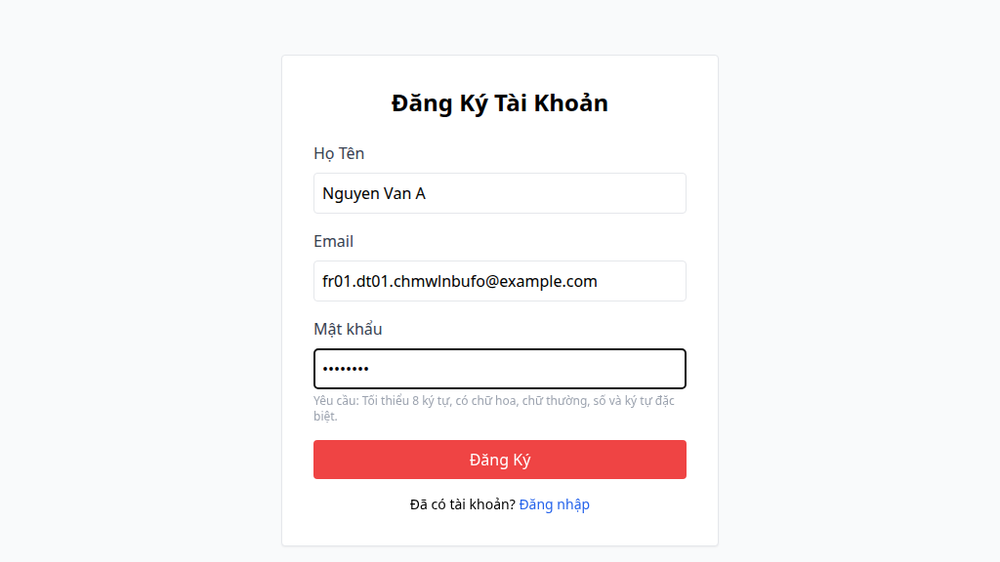

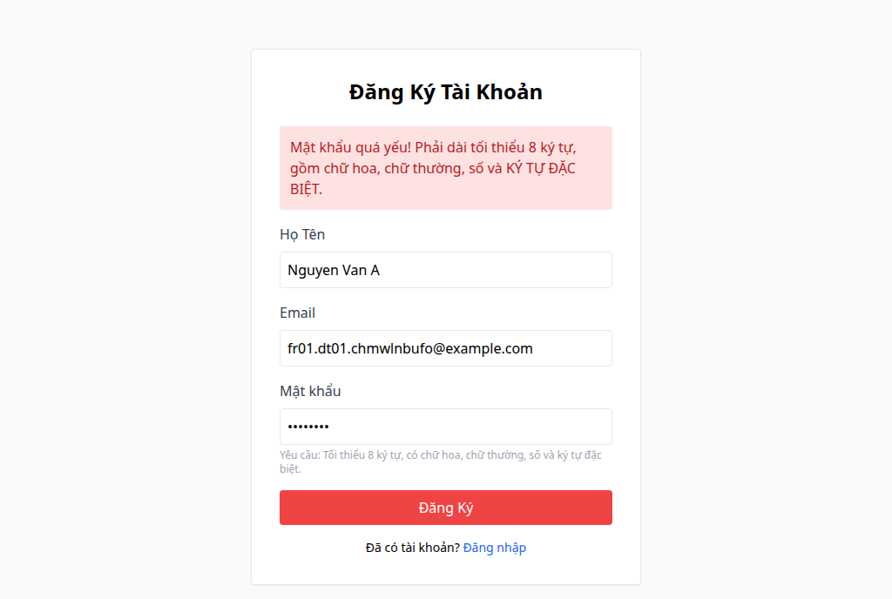

### 2.7 BUG-16 (issue #16; trùng nội dung #113) – Form Đăng ký thiếu ô Xác nhận mật khẩu

- **Đặc tả (FR-01, S4):** "Phải có trường **Xác nhận mật khẩu** — hệ thống từ chối nếu hai trường không khớp."
- **Test case:** FR01-DT-27 (Xác nhận `Abcdef2@` khác Mật khẩu `Abcdef1@`).
- **Các bước:** mở `/register`, tìm ô có nhãn "Xác nhận mật khẩu".
- **Mong đợi:** form có ô Xác nhận mật khẩu; nhập hai giá trị khác nhau thì bị từ chối vì không khớp.
- **Thực tế:** form chỉ có Họ Tên, Email, Mật khẩu (assertion "form phải có ô Xác nhận mật khẩu (S4)" fail: 0 phần tử). Lý do từ chối thực tế là mật khẩu (BUG-15), không phải "không khớp".
- **Ảnh:** từ `reports/fr01-chromium/`, test FR01-DT-27.


### 2.8 BUG-18 (issue #18) và BUG-21 (issue #21; trùng nội dung #111) – Email sai định dạng vẫn đăng ký được

- **Đặc tả (FR-01, S2):** "Email phải có định dạng hợp lệ (`user@domain.com`)". FR-22: "Trường Email phải dùng `type="email"`."
- **Test case:** FR01-WA-11 (case bổ sung ở HW04, biến thể của FR01-DT-11). DT-11 gốc không tới được bước này vì BUG-15.
- **Các bước:** như 2.6, Email `fr01.wa11.<hậu tố>example.com` (không có `@`), Mật khẩu `Abcdef1␣` (mật khẩu duy nhất form đang nhận).
- **Mong đợi:** từ chối; không có tài khoản nào được tạo với email đó.
- **Thực tế:** ô Email là `type="text"` nên trình duyệt không kiểm (BUG-21); `POST /api/register` trả 200 (BUG-18); tài khoản có email không có `@` xuất hiện trong `GET /api/admin/users`; trang chuyển sang Đăng nhập.
- **Giới hạn của case:** mật khẩu `Abcdef1␣` cũng sai theo S3, nên case không cô lập được lỗi email; nó chứng minh SUT đã nhận một lượt đăng ký vi phạm S2.
- **Bằng chứng:** từ `reports/fr01-chromium/`, test FR01-WA-11. Ảnh cho thấy ô Email nhận chuỗi không có `@`; tệp đính kèm "Tài khoản mới phía server sau thao tác" cho thấy SUT đã tạo tài khoản:

  ```json
  [{"id": 5, "name": "Nguyen Van A", "email": "fr01.wa11.chmwlncka6example.com"}]
  ```


### 2.9 BUG-19 (issue #19) – Server nhận mật khẩu không đủ mạnh

- **Đặc tả (FR-01, S3):** như 2.6.
- **Test case:** FR01-DT-29.
- **Các bước:** như 2.6, Mật khẩu `Abcdef1␣`.
- **Mong đợi:** từ chối (phản hồi ≥ 400), không tạo tài khoản.
- **Thực tế:** `POST /api/register` trả 200 và tạo tài khoản; trang chuyển sang Đăng nhập.
- **Bằng chứng:** từ `reports/fr01-chromium/`, test FR01-DT-29. Mật khẩu `Abcdef1␣` bị che dạng chấm nên ảnh form chỉ cho thấy dữ liệu đã nhập; bằng chứng chính là tệp đính kèm "Tài khoản mới phía server sau thao tác" và phản hồi 200 trong danh sách assertion fail của report:

  ```json
  [{"id": 4, "name": "Nguyen Van A", "email": "fr01.dt29.chmwlncelg@example.com"}]
  ```


### 2.10 BUG-20 (issue #20; trùng nội dung #112) – Cho đăng ký bằng email đã tồn tại

- **Đặc tả (FR-01, S2):** "Email … là duy nhất trong hệ thống."
- **Test case:** FR01-WA-17 (case bổ sung ở HW04, biến thể của FR01-DT-17). DT-17 gốc không tới được bước này vì BUG-15.
- **Các bước:**
  1. Tạo trước một tài khoản qua `POST /api/register` (email `fr01.wa17.seed.<hậu tố>@example.com`).
  2. Trên `/register`, đăng ký lại với đúng email đó, Mật khẩu `Newpass1␣`.
- **Mong đợi:** từ chối; không thêm tài khoản; tài khoản có sẵn vẫn đăng nhập được.
- **Thực tế:** `POST /api/register` trả 200; `GET /api/admin/users` có thêm một tài khoản thứ hai cùng email; trang chuyển sang Đăng nhập.
- **Bằng chứng:** từ `reports/fr01-chromium/`, test FR01-WA-17. Ảnh cho thấy email nhập vào là email của tài khoản tạo ở setup; tệp đính kèm "Tài khoản mới phía server sau thao tác" cho thấy SUT đã tạo thêm một tài khoản mang đúng email đó (tài khoản setup được tạo trước bước chụp "trước thao tác", nên không nằm trong danh sách này):

  ```json
  [{"id": 7, "name": "Nguyen Van A", "email": "fr01.wa17.seed.chmwlncn0m@example.com"}]
  ```

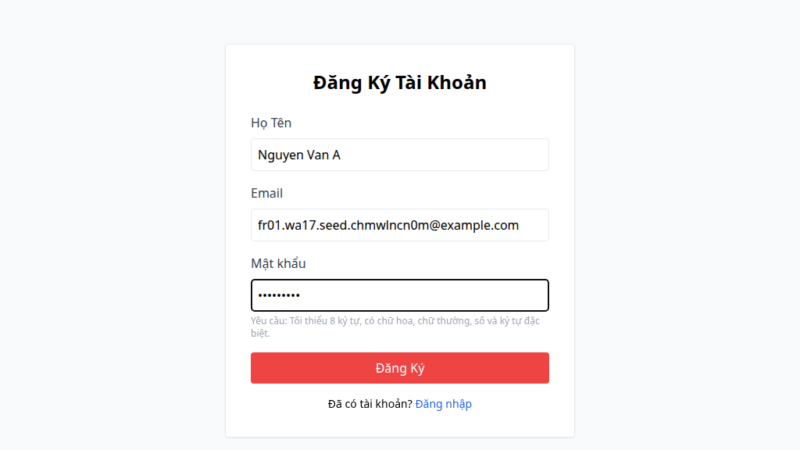

### 2.11 BUG-30 (issue #30) – Đơn đã hủy chuyển được sang "Đã giao"

- **Đặc tả (FR-10, S2):** "Trạng thái `delivered` và `canceled` là **trạng thái kết thúc** — không được phép chuyển sang bất kỳ trạng thái nào khác." S4: "Mọi chuyển đổi không hợp lệ phải trả về lỗi với thông báo phù hợp."
- **Test case:** FR10-DT-09 (bấm nút), FR10-UI-01 (bộ nút ở trạng thái kết thúc, case bổ sung ở HW04).
- **Các bước:**
  1. Tạo một đơn của tài khoản user (`POST /api/checkout`), Admin chuyển sang `canceled`.
  2. Web Admin → mục Đơn hàng: dòng của đơn đó hiện "Đã hủy" và có nút "Đánh dấu Đã giao".
  3. Bấm nút.
- **Mong đợi:** dòng đơn Đã hủy không có nút nào; nếu gửi chuyển thì server trả ≥ 400 và đơn giữ `canceled`.
- **Thực tế:** có nút "Đánh dấu Đã giao"; `PUT /api/admin/orders/<id>/status` trả 200; đơn thành "Đã giao" trên giao diện và `delivered` phía server.
- **Ảnh:** từ `reports/fr10-chromium/`. Test FR10-DT-09, đơn #8 trước và sau khi bấm; test FR10-UI-01, đơn #17 Đã hủy.

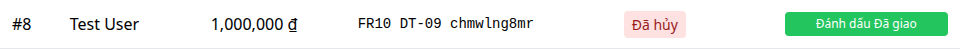

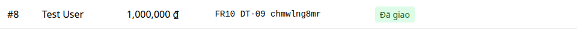

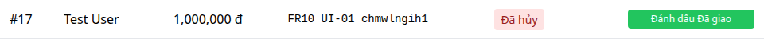

### 2.12 BUG-31 (issue #31; trùng nội dung #115) – User hủy được đơn đang giao

- **Đặc tả (FR-10, S3):** "Khi đơn hàng đã ở trạng thái `shipping`, **User không được phép tự hủy**."
- **Test case:** FR10-DT-14 (bấm nút), FR10-DT-27 (bộ nút của trang Hồ sơ).
- **Các bước:**
  1. Tạo một đơn của tài khoản user, Admin chuyển `pending → confirmed → shipping`.
  2. Đăng nhập Web bằng tài khoản user, mở trang Hồ sơ: dòng đơn "Đang giao" có nút "Hủy đơn".
  3. Bấm nút.
- **Mong đợi:** không có nút hủy ở đơn Đang giao; nếu gửi yêu cầu thì server trả ≥ 400, đơn giữ `shipping`, không báo thành công.
- **Thực tế:** có nút; bấm là hủy ngay, không hỏi xác nhận; `PUT /api/orders/<id>/cancel` trả 200; alert "Hủy đơn thành công!"; đơn thành "Đã hủy".
- **Ảnh:** từ `reports/fr10-chromium/`. Test FR10-DT-14, đơn #9 trước và sau khi bấm; test FR10-DT-27, đơn #15 Đang giao.

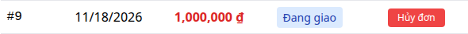

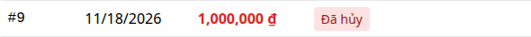

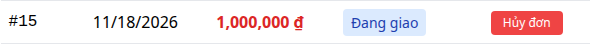

## 3. Việc còn lại

- [ ] Ảnh chụp trang GitHub Issues của 5 issue trên.
- [x] Chạy lại ba lượt chính thức của FR-15 để report trong repo có ảnh bảng sản phẩm (2026-11-18).
- [x] Bug của FR-01 và FR-10: đã soạn mục 2.6–2.12 (bản nháp).
- [x] Chép ảnh của FR-01 và FR-10 từ report chính thức vào `bugs/screenshots/` và chèn vào mục 2.6–2.12; đã mở từng ảnh. Ảnh form của FR01-DT-29 không tự cho thấy lỗi (mật khẩu bị che), nên mục 2.9 dựa vào tệp JSON phía server.
- [ ] Đọc lại và viết lại mục 2.6–2.12 bằng lời của bạn (AI-1 soạn).
