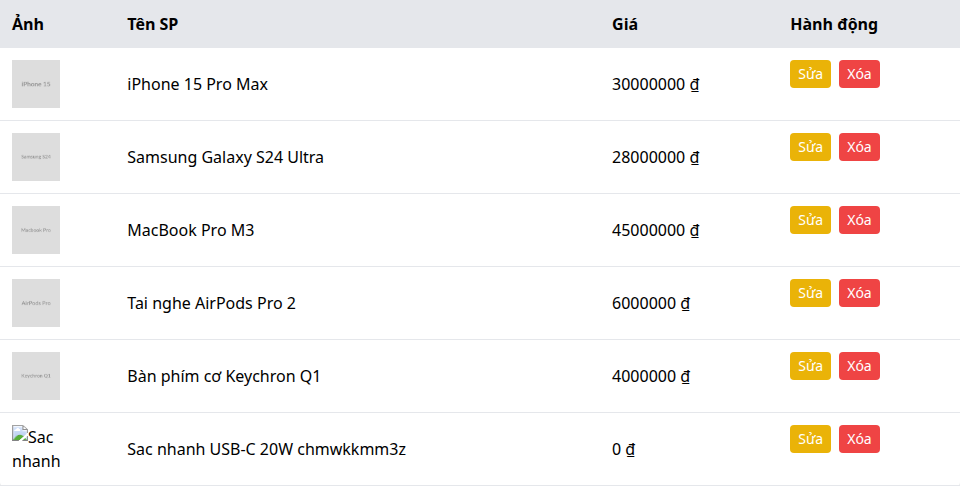
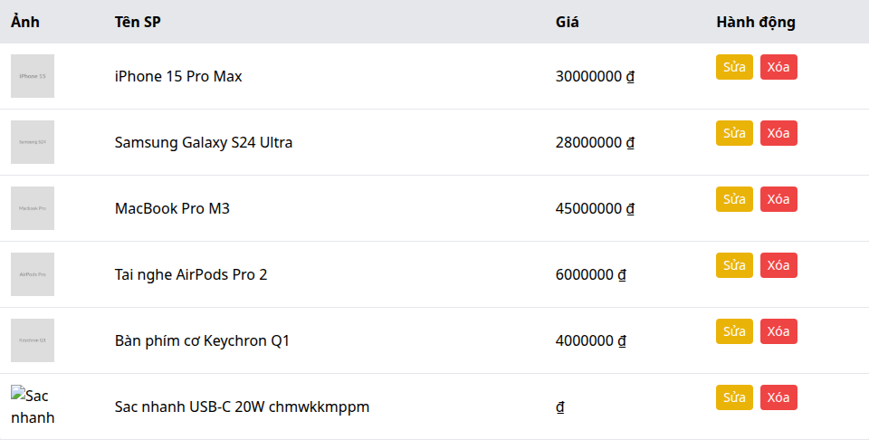
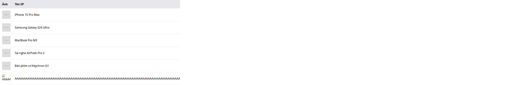

# Bug report – HW04 Automation Testing

Các bug dưới đây do bộ test tự động làm lộ ra: một assertion fail và nguyên nhân là SUT làm sai đặc tả. Issue nằm ở repo dùng chung của nhóm: `d1nhnguyen/eshop-sut`.

## 1. Tổng hợp

| Bug | Issue | Feature | Tóm tắt | Mức độ | Test case tự động làm lộ ra | Browser |
| --- | --- | --- | --- | --- | --- | --- |
| BUG-24 | [#24](https://github.com/d1nhnguyen/eshop-sut/issues/24) | FR-15 | Cho lưu Giá bằng 0 hoặc âm khi Thêm và Sửa | Major | FR15-DT-08, FR15-DT-09, FR15-DT-20 | Chromium, Firefox, WebKit |
| BUG-25 | [#25](https://github.com/d1nhnguyen/eshop-sut/issues/25) | FR-15 | Cho lưu khi bỏ trống Giá | Major | FR15-DT-10 | Chromium, Firefox, WebKit |
| BUG-26 | [#26](https://github.com/d1nhnguyen/eshop-sut/issues/26) | FR-15 | Cho lưu Tên dài hơn 255 ký tự | Major | FR15-BV-05 | Chromium, Firefox, WebKit |
| BUG-27 | [#27](https://github.com/d1nhnguyen/eshop-sut/issues/27) | FR-15 | Cho lưu Tên chỉ gồm khoảng trắng | Major | FR15-DT-06 | Chromium, Firefox, WebKit |
| BUG-41 | [#87](https://github.com/d1nhnguyen/eshop-sut/issues/87) | FR-15 | Sau khi Sửa, bảng sản phẩm hiển thị sai cho tới khi tải lại trang | Major (tôi đề xuất) | FR15-DT-15, FR15-DT-34, FR15-DT-20 | Chromium, Firefox, WebKit |

**Lưu ý về mã bug:** `BUG-41` là mã trong tiêu đề của **issue #87**, không phải issue #41. Từ HW03, mã BUG-xx của nhóm không còn trùng với số issue trên GitHub. BUG-24 đến BUG-27 thì trùng số issue #24 đến #27.

Nguồn gốc issue:

- BUG-24 đến BUG-27 do tôi tạo ở HW02 (kiểm thử thủ công và qua API). HW04 tái hiện lại chúng bằng test tự động trên Web Admin. Mức độ giữ theo HW02.
- BUG-41 do thành viên khác trong nhóm tạo ngày 2026-11-10. Test của tôi tái hiện bug này và bổ sung ba chi tiết ở mục 2.5.

Bằng chứng:

- **Kết quả chạy:** mở `reports/fr15-<browser>/index.html`, chọn test case tương ứng. Mỗi test fail có danh sách assertion fail và annotation `Bug`.
- **Ảnh:** năm ảnh trong `bugs/screenshots/` chụp riêng bảng sản phẩm ngay sau thao tác. Chúng do chính test tự động chụp trong một lượt chạy riêng trên Chromium ngày 2026-11-17, sau khi test được bổ sung bước chụp bảng (commit `328221b`). Ba report hiện có trong `reports/` được chạy trước đó nên **không chứa các ảnh này**; ảnh tự động lúc fail trong ba report đó chỉ chụp khung nhìn và không thấy dòng lỗi ở cuối bảng.
- **Trên GitHub:** mỗi issue có một bình luận ngày 2026-11-17 kèm đúng ảnh tương ứng.

## 2. Chi tiết

### 2.1 BUG-24 – Cho lưu Giá bằng 0 hoặc âm khi Thêm và Sửa

- **Đặc tả (FR-15):** "Giá: bắt buộc, phải là số **dương** (> 0)."
- **Test case:** FR15-DT-08 (Thêm, Giá `0`), FR15-DT-09 (Thêm, Giá `-50000`), FR15-DT-20 (Sửa Giá thành `0`).
- **Các bước (Thêm):**
  1. Đăng nhập Web Admin bằng tài khoản admin, mở mục Sản phẩm.
  2. Nhập Tên `Sac nhanh USB-C 20W <hậu tố>`, Giá `0` (hoặc `-50000`), chọn Danh mục `Phụ kiện`.
  3. Bấm "Lưu sản phẩm".
- **Mong đợi:** hệ thống từ chối; không có sản phẩm mới trên bảng và phía server.
- **Thực tế:** `POST /api/products` trả 200; bảng có thêm một dòng; `GET /api/products` có thêm một sản phẩm.
- **Thực tế (Sửa, FR15-DT-20):** `PUT /api/products/<id>` trả 200; phía server Giá của sản phẩm thành `0` thay vì giữ `28000000`.
- **Ảnh:** `bugs/screenshots/BUG-24_FR15-DT-08_chromium_table.png` ([bình luận trên issue](https://github.com/d1nhnguyen/eshop-sut/issues/24#issuecomment-6945939330))

### 2.2 BUG-25 – Cho lưu khi bỏ trống Giá

- **Đặc tả (FR-15):** "Giá: bắt buộc, phải là số **dương** (> 0)."
- **Test case:** FR15-DT-10.
- **Các bước:** như 2.1, để trống ô Giá.
- **Mong đợi:** hệ thống từ chối; không có sản phẩm mới.
- **Thực tế:** `POST /api/products` trả 200; bảng và server có thêm một sản phẩm. Ô Giá không có thuộc tính bắt buộc nên trình duyệt không chặn.
- **Ảnh:** `bugs/screenshots/BUG-25_FR15-DT-10_chromium_table.png` ([bình luận trên issue](https://github.com/d1nhnguyen/eshop-sut/issues/25#issuecomment-6945940225))

### 2.3 BUG-26 – Cho lưu Tên dài hơn 255 ký tự

- **Đặc tả (FR-15):** "Tên sản phẩm: bắt buộc, tối đa 255 ký tự."
- **Test case:** FR15-BV-05 (Tên 256 ký tự). Case cặp FR15-BV-04 (Tên 255 ký tự) pass.
- **Các bước:** như 2.1, nhập Tên dài đúng 256 ký tự, Giá `350000`.
- **Mong đợi:** hệ thống từ chối; không có sản phẩm mới.
- **Thực tế:** ô Tên nhận đủ 256 ký tự; yêu cầu gửi đi mang Tên dài 256 ký tự; `POST /api/products` trả 200; bảng và server có thêm một sản phẩm.
- **Ảnh:** `bugs/screenshots/BUG-26_FR15-BV-05_chromium_table.png` ([bình luận trên issue](https://github.com/d1nhnguyen/eshop-sut/issues/26#issuecomment-6945941119))

### 2.4 BUG-27 – Cho lưu Tên chỉ gồm khoảng trắng

- **Đặc tả (FR-15):** "Tên sản phẩm: bắt buộc, tối đa 255 ký tự." Giả định A2 của HW02: tên chỉ gồm khoảng trắng coi như bỏ trống.
- **Test case:** FR15-DT-06. Case cặp FR15-DT-05 (Tên rỗng) pass vì trình duyệt chặn.
- **Các bước:** như 2.1, nhập Tên là 3 dấu cách, Giá `350000`.
- **Mong đợi:** hệ thống từ chối; không có sản phẩm mới.
- **Thực tế:** `POST /api/products` trả 200; bảng và server có thêm một sản phẩm có Tên là 3 dấu cách (trên bảng hiện ô Tên trống).
- **Ảnh:** `bugs/screenshots/BUG-27_FR15-DT-06_chromium_table.png` ([bình luận trên issue](https://github.com/d1nhnguyen/eshop-sut/issues/27#issuecomment-6945942070))

### 2.5 BUG-41 (issue #87) – Sau khi Sửa, bảng sản phẩm hiển thị sai cho tới khi tải lại trang

- **Đặc tả (FR-15):** "Khi Sửa một sản phẩm, chỉ sản phẩm đó bị thay đổi — các sản phẩm khác giữ nguyên."
- **Test case:** FR15-DT-15, FR15-DT-34 (Sửa Giá hợp lệ); FR15-DT-20 cũng gặp hiện tượng này.
- **Các bước:**
  1. Tạo một sản phẩm `MacBook Pro M3 <hậu tố>`, Giá `45000000`, Danh mục `Laptop`.
  2. Trên Web Admin, mục Sản phẩm, bấm "Sửa" ở dòng của sản phẩm đó.
  3. Chỉ đổi Giá thành `42000000`, bấm "Lưu sản phẩm", đóng alert "Cập nhật thành công!".
  4. Quan sát bảng, không tải lại trang.
- **Mong đợi:** dòng được sửa hiện Giá `42000000`; Tên và Giá của mọi dòng khác giữ nguyên.
- **Thực tế:**
  - Cột Tên của **mọi dòng** trong bảng đổi thành tên của sản phẩm vừa sửa.
  - Dòng được sửa vẫn hiện Giá cũ `45000000`.
  - Phía server dữ liệu đúng: chỉ sản phẩm được sửa đổi Giá, các sản phẩm khác không đổi. Tải lại trang thì Tên của các dòng hiển thị lại đúng.
- **Bổ sung so với issue #87:** issue gốc mô tả trường hợp sửa Tên. Test tự động cho thấy lỗi xảy ra cả khi chỉ sửa Giá, dòng được sửa không cập nhật Giá mới, và đây là lỗi hiển thị (dữ liệu phía server không bị đổi).
- **Ảnh:** `bugs/screenshots/BUG-41_FR15-DT-15_chromium_table.png` ([bình luận trên issue](https://github.com/d1nhnguyen/eshop-sut/issues/87#issuecomment-6945943089))

## 3. Việc còn lại

- [ ] Ảnh chụp trang GitHub Issues của 5 issue trên.
- [ ] Chạy lại ba lượt chính thức của FR-15 để report trong repo có ảnh bảng sản phẩm (làm cùng 9 lượt chính thức cuối).
- [ ] Bug của FR-01 và FR-10.
